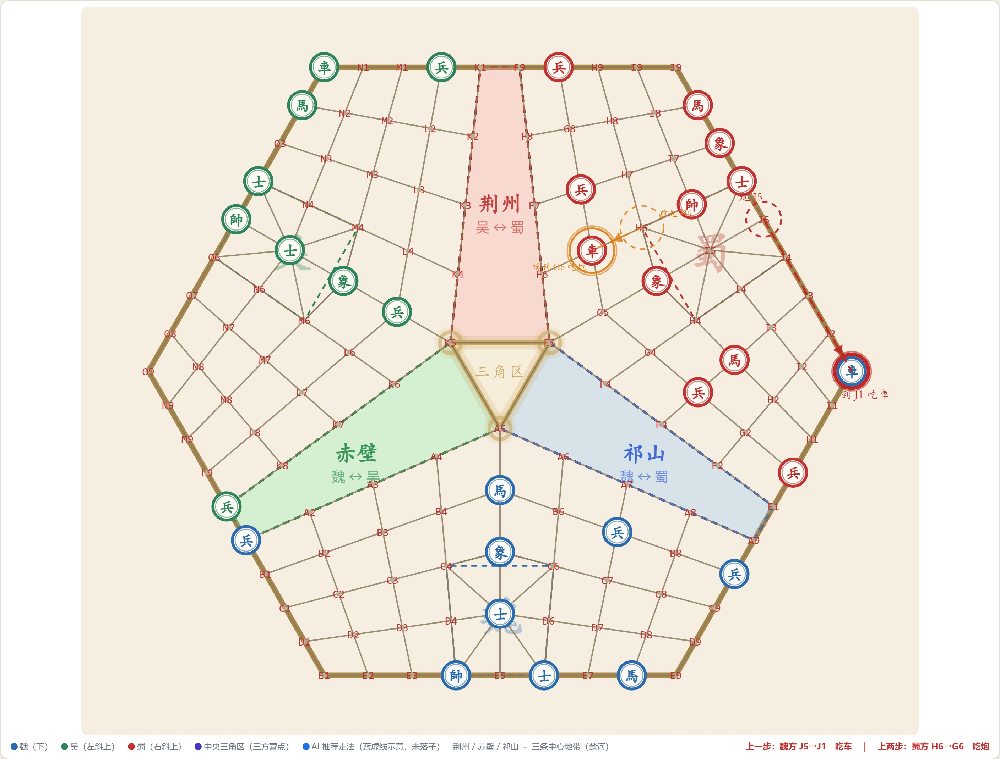
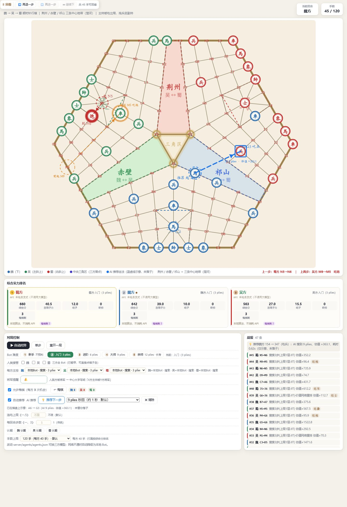
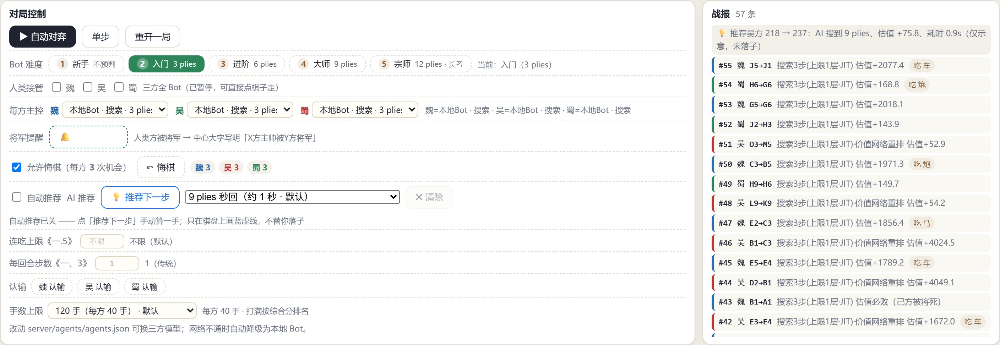

# 三人中国象棋 · 专利版

> **把"楚河汉界"那道线打断，让棋盘长出第三个方向 —— 一个正六边形上、三方同时厮杀的中国象棋。**

魏、吴、蜀三足鼎立，各占 45 个点位，顺时针轮转行棋。没有"你死我活"的二元对立，
每一手都要同时评估两个对手 —— 因为**两方随时可能联手先把你吃掉**。

这不是"把两人棋加一方"的换皮：规则带 **军帐 / 副帅 / 生命力 / 战斗力 / 照见射杀** 等
一整套专利差异，棋盘几何由 CAD 工程图（135 个 POINT + 51 条 POLYLINE）权威确定。



---

## 在线体验

**<https://three-player-chess.app.workbuddy.host/?sharecode=5SRKKKXXS6>**

（链接必须带 `?sharecode=`，去掉会 403。开通即三方全 Bot 自动对弈，可直接围观。）



---

## 三人象棋难在哪里

两人象棋的数学本质是**零和博弈**：我赢一分你必输一分，minimax + alpha-beta 天然成立。
三方象棋把这块地基抽掉了：

| 难点 | 具体表现 | 本项目的解法 |
|---|---|---|
| **非零和** | 我吃掉魏国一个车，我没得分、吴国也没失分 —— 收益不守恒 | **paranoid（偏执）搜索**：把另两方都当"敌人"，博弈树重新回到零和，alpha-beta 才能用 |
| **二打一困境** | 两方联手先吃掉第三方，剩下再分胜负 | 规则内置**连吃上限**约定（《一、5》） |
| **镜像平局** | 三方完全对称的开局走镜像着法会**永远平局** | 搜索加**探索噪声**，让某一方先"走岔" |
| **信息量 3 倍** | 谁在威胁谁？三方关系一眼看不出来 | 实时**综合实力排名**、将军告警、被吃子清单、逐手战报 |

---

## 棋盘：一个正六边形，135 个点位

```
                    蜀（上）
                 F G H I J
              ┌──────────────┐
      魏(左下) │   ↖ 赤壁  ↗   │ 吴(右下)
         A-E   │  ← 荆州 →    │  K-O
              └──────────────┘
              魏 → 吴 → 蜀 顺时针
```

- 正六边形平顶朝向；每方 5 行 × 9 列 = 45 点，三方共 **135 点**，开局 **48 子**
  （每方 1 帅 + 2 车马炮象士 + 5 兵）
- **三条中心地带**：赤壁（魏↔吴）｜荆州（蜀↔吴）｜祁山（魏↔蜀）
- 坐标：字母是行（魏 `A-E`、蜀 `F-J`、吴 `K-O`），数字是 `10 − 列`
- **15 条贯通纵线**：底边数字之和为 10 的两点属同一纵线 ⇒ 车炮能一路杀到对面老家

**⚠️ 一条几何铁律**：DXF 是变形网格，**格距 13~24 不等** ⇒ 长度与夹角没有任何判据意义。
所有共线关系一律以射线表**实测枚举**为准，不按角度推算。
（最大折角 47.58° > 方向族最小夹角 35.412°，用角度判共线必然串味。）

---

## 规则亮点

完整 21 条专利差异见 [`docs/专利版规则.md`](docs/专利版规则.md)，规则唯一权威源是
[`docs/三人中国象棋的游戏规则.md`](docs/三人中国象棋的游戏规则.md)。

### 副帅：吃掉对方帅的那枚棋子，"就地升格"

传统象棋吃掉帅就结束了。这里不是：**吃掉 A 方主帅的那枚棋子就地变身成 B 方副帅**，
原棋子从盘上消失，位置就在被吃帅的原位（必在军帐内 ⇒"副帅不能出军帐"自动成立）。
于是"吃掉对方主帅"从**终结**变成了**易主**——你吃掉的不是一枚棋子，是把对方的帅收编成了自己的将军。

### 照见即可射杀（本版最大的规则改动）

- 帅照面**合法**，而且**轮到谁，谁就能吃**
- **主帅与副帅同权**，都能射杀
- 只打对方**帅 / 副帅**；普通子挡在线上则打不动、也不穿透
- 沿**见面线**（六条跨方贯通线）生效
- 后果是**吃子**：对方帅从盘上消失 ⇒ 该方出局 + 残兵易主

> 既然照见即可射杀，传统的"禁止照面"与"被动判负"两条同时失去意义 ⇒ **一并退役**。
> 这一改动由一句质疑撬动：「副帅已经照见 I5 的主帅，又轮到魏走，为何不能射杀？」

### 生命力 / 战斗力：只有"有 / 无"

- **生命力**：本方主帅是否还在盘上（副帅不算主帅）
- **战斗力**：主帅在，或手里握着别方副帅
- **出局唯一触发 = 主帅被吃**（判负、认输都不算出局）
- **不存在求和**，只允许认输；残局只剩象/士/帅时跑满 **9 轮**自动判平

### 其他

| 规则 | 内容 |
|---|---|
| 军帐 | 每方九宫 3×3 = 9 点，主帅与副帅**只能在这 9 个点里活动** |
| 兵 | 只能前进不能后退；**一辈子只能过一次界**；过界后可横走 |
| 马 | 蹩腿与传统完全一致；**可以过河**；三角区有 6 对特殊回跳（双向 12 向） |
| 送将 | **允许**（弃子诱敌是正经战术），红线只剩"不可主动让帅见面" |
| 重复着法 | 无向边记录，`REPEAT_LIMIT=3`；重复且给将判负，否则判和 |

---

## 技术架构

```
server/                     引擎 + HTTP 服务（13,983 行）
  engine/geometry_dxf.py    135 点位 / 邻居 / 坐标标签
  engine/rules_dxf.py       7 张走法表 + 射线表 + 见面线
  engine/game_dxf.py        规则判定、副帅生成、终局与判平
  engine/patent.py          专利规则状态机（军帐 / 副帅账本 / 生命力战斗力）
  agents/search_bot.py      paranoid alpha-beta 搜索引擎
  agents/features_dxf.py    32 维特征（含 12 维"子力安危"）
  agents/value_net.py       价值网络（LogiNet 可解释 / MLPNet 能打）
  agents/difficulty.py      5 档难度
  match.py                  对局状态机、悔棋、快照、续局
  app.py                    HTTP 接口

web/                        对弈台前端（2,618 行，Canvas 绘制，零框架依赖）
tools/                      云端训练线（3,820 行：调度 / 自对弈 / 训练 / A-B 门禁）
tests/                      118 个验收脚本
docs/                       规则、版本日志、完善历程、分析报告
```

**AI 分两层**：搜索（paranoid alpha-beta）+ 价值网络（按座位配，仅吴方开 λ=0.35）。
难度 **5 档**：新手 0 / 入门 3 / 进阶 6 / 大师 9 / 宗师 12 plies（默认第 2 档）。
「AI 推荐（给人看的提示）」默认 **9 plies**，与难度档是两件事。

---

## 快速开始

```bash
pip install -r requirements.txt
python server/app.py            # 默认 http://127.0.0.1:8771/
python server/app.py --demo     # 演示模式：三方全 Bot，不用手动走棋
```

在浏览器打开 `http://127.0.0.1:8771/`。端口取 `PORT` 环境变量（有则绑 `0.0.0.0`），
`GET /healthz` 供平台探活。

**依赖**：`numpy` 是硬依赖；`numba` 是软依赖（缺失会自动降级到纯 Python 搜索，只是慢）。
`torch` 不在依赖里 —— 价值网络是纯 numpy 实现。

### 手数上限可调

网页「对局控制 → 手数上限」可实时调 **24–300**，默认 **120（每方 40 手）**。
接口：`POST /api/options {"max_ply": N}`。只改内存不写文件，重启回到默认值。

> 口径：一人一手 = 1 ply，三人一轮 = 3 plies ⇒「120 手」= 每方 40 手。
> 打满上限仍分不出胜负时按综合实力分排名：
> **斩帅×1000 + 在场子力×8 + 吃子×3 + 存活 300 − 回退×20**。



---

## 测试

```bash
python tests/test_dxf.py          # 总门禁 106 项（引擎全量）
python tests/_verify_snipe.py     # 射杀 72 项（含 6075 个跨方点对穷举）
node  tests/_verify_hint_ui.js    # 前端 DOM 桩，真触发事件看回调
node  tests/_verify_maxply.js     # 手数上限 + 排版，37 项
```

`tests/` 共 **118** 个脚本：断言型 **51**（`_verify_*` 50 + `test_*` 1）、
探针 **44**（`_probe_*`）、截图/标定/构建等辅助 **23**。

两条测试纪律值得单独说：

1. **带证伪自检**：关键探针会把实现换回修复前的版本，断言它**确实变红** ——
   否则你无法区分"修好了"和"判据根本测不到问题"。
2. **变异测试防假绿**：改动实现注入错误，探针必须变红。曾出现过参数写反导致
   标签恒为 `true`、掩盖了 13 个 FAIL 的事故。

---

## 版本历程

八个台阶，每一阶都由一次质疑或一次拍板触发（完整版见
[`docs/项目完善历程.md`](docs/项目完善历程.md)）：

| 版本 | 日期 | 主题 | 触发点 |
|---|---|---|---|
| V0.1 | 09-22 | 引擎骨架 + DXF 变形棋盘 | 拿到 CAD 工程图 |
| V0.2 | 09-24 | 专利版三态规则（生命力/战斗力砍成二值） | 「只有有/无，不需要具体数值」 |
| **V0.3** | 09-25 | ★ 照见即可射杀，被动判负退役 | 「副帅已照见 I5 主帅，为何不能射杀？」 |
| V0.4 | 09-26 | 网页对弈台 + 难度档 + 坐标标签 | 「难度档位网页里能选，默认第二档」 |
| **V0.5** | 10-01 | 32 维特征 + 价值网络 | 「车走一步马就白送了，给我理由」 |
| **V0.6** | 10-01~02 | 云端训练线 + A/B 裁判 | 「GPU 空置，要好好运用」「动手修根因」 |
| V0.7 | 10-02 | 终局悔棋自救 / 幽灵副帅 / 推荐 12→9 plies | 逐条点名 |
| V0.8 | 10-25 | 上线 + 手数上限可调 | 「做成可调」「把这个版本发上去」 |

**V0.5 是全项目分水岭**：它把"AI 棋力不行"从**算法问题**重新定义成**特征问题** ——
value head 只是「特征 → 胜率」的映射，**特征里没有"我的子正被白吃"这一维，换 AlphaZero 也学不出来**。
这个判断决定了后面 20 小时云端训练该往哪使劲，而不是盲目加深搜索。

---

## 已知局限（如实列，不粉饰）

1. **云端训练线的冠军未被替换** —— 两轮真实门禁 Δ−7 / Δ−31 全拒，训练继续但棋力没再涨。
2. **两批自对弈数据互相预测不了**（交叉泛化掉 0.08~0.11），至今无解释，只如实记录。
3. **价值网络只按座位配了一方**（吴），魏/蜀显式关闭 —— 不是全局提升。
4. **副帅账本的 `pos` 字段全工程无人维护**，目前靠 `home` 绕开，未真正清理。
5. 上线后只做过 390 宽的模拟验证，**没有多档手机真机回归**。
6. 三个云端训练归档目录（264 MB）**未纳入本仓库**（单个 npz 129 MB 超 GitHub 硬限），
   内容与结论见 `docs/云端训练线_收场报告_20261002.md`。

---

## 授权

**版权所有，保留一切权利。** 本仓库公开用于阅读、评审与学术讨论；
未经书面许可，不得用于商业用途或再分发。若需其他授权方式，请通过 Issue 联系。

---

*专利规则源：`docs/三人中国象棋的游戏规则.md` · 棋盘几何源：`三人版中国象棋.dxf`*
